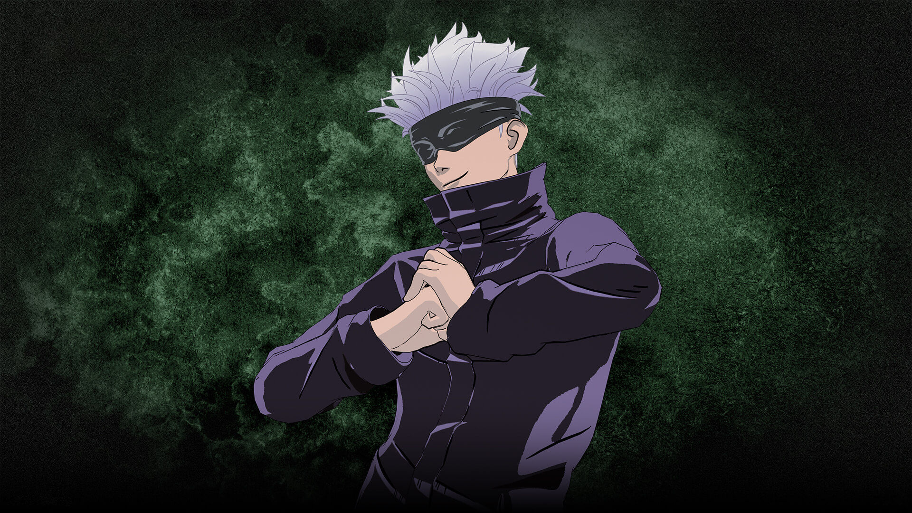

<html lang="vi">
<head>
  <meta charset="UTF-8">
  <meta name="viewport" content="width=device-width, initial-scale=1.0">
  <title>wed hải anh coder</title>
  
</head>
<body>
    <!-- NỀN VIDEO -->
<video autoplay loop muted playsinline id="background-video">
  <source src="./cid-kagenou-the-eminence-in-shadow.960x540.mp4" type="video/mp4">
</video>

  <h1 style="color: white;">Chào mừng bạn đến với wed của hải anh coder</h1>

  <!-- Form Đăng Nhập -->
  

    
    <h2>Đăng nhập</h2>
    <form action="tap2.html" target="_blank" method="post">
      <input type="text" placeholder="Tên đăng nhập" required>
      <input type="password" placeholder="Mật khẩu" required>
      <button>ĐĂNG NHẬP</button>
    </form>
    
Bạn chưa có tài khoản? <a onclick="toggleForm()">Đăng ký</a>

    

      
<i class="fa fa-phone"></i> 0986931896

      
<i class="fa fa-envelope"></i> haicube207@gamil.com

      
<em>Hãy sống hết mình vì coder</em>

    

  

  <!-- Form Đăng Ký --> 
  

    
    <h2>Đăng ký tài khoản</h2>
    <form action="dangkithanhcong.html" target="_blank" method="get">
      <input type="text" placeholder="Họ và tên" required>
      <input type="text" placeholder="Tên đăng nhập" required>
    <input type="email" placeholder="Email" required>
    <input type="tel" placeholder="Số điện thoại" required>
    <input type="password" placeholder="Mật khẩu" required>
    <input type="password" placeholder="Xác nhận mật khẩu" required>
    <button>ĐĂNG KÝ</button>
    
Đã có tài khoản? <a onclick="toggleForm()">Đăng nhập</a>

  

  
   

    <!-- Facebook icon (click opens Facebook profile) -->
    <a class="fb-icon" href="https://www.facebook.com/hai.ahhhh" target="_blank" rel="noopener noreferrer" title="Mở Facebook">
      <!-- simple 'f' svg -->
      <svg viewBox="0 0 24 24" aria-hidden="true"><path d="M22 12.07C22 6.49 17.52 2 11.94 2S2 6.49 2 12.07c0 4.99 3.66 9.13 8.44 9.95v-7.04H8.1v-2.91h2.34V9.41c0-2.31 1.37-3.58 3.47-3.58.99 0 2.03.18 2.03.18v2.21h-1.13c-1.12 0-1.47.7-1.47 1.42v1.7h2.5l-.4 2.91h-2.1v7.04C18.34 21.2 22 17.07 22 12.07z"/></svg>
    </a>

    

      <!-- Laptop image card -->
      

        <!-- Thay src bằng đường dẫn ảnh của bạn hoặc url -->
        
      

      <!-- Nút liên hệ: mở Facebook profile (mở tab mới) -->
      <a class="contact-btn" id="contactBtn" href="https://www.facebook.com/hai.ahhhh" target="_blank" rel="noopener noreferrer">
        liên hệ in4
      </a>
    

    <!-- Nút chuyển trang nội bộ -> other.html -->
    <a class="goto" id="gotoBtn" href="tap3.html" title="Chuyển trang">
      trang share code →
    </a>
  

  

</body>
</html>
